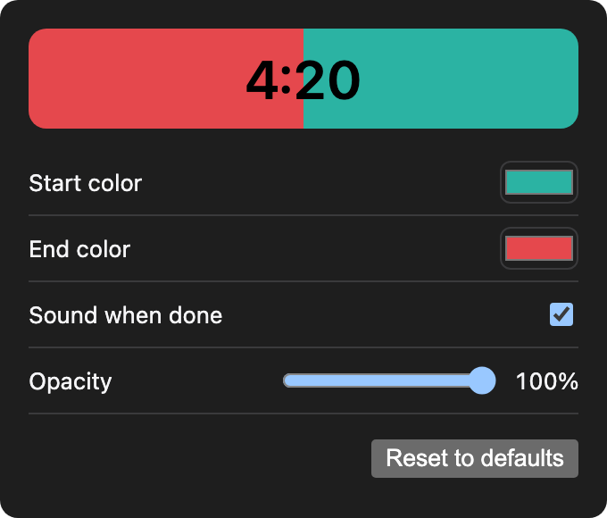

# Floating Timer

A small countdown timer for macOS and Windows that floats above every other window. Type `10m` or `until 8:30 am`, press Enter, and the background fills from one color to another like a progress bar as time runs out.

<p>
  
  &nbsp;
  
</p>



## Features

- **Always on top**, as a borderless, rounded window that stays out of the Dock and taskbar. On macOS it also floats over full-screen apps and on every Space.
- **Plain-language input**: durations (`10m`, `1h30`, `90s`) or clock times (`until 8 am`, `until 17:45`), with a live "ends at…" preview as you type.
- **Progress sweep**: a hard-edged fill from the start color to the end color, with digits that stay readable on both colors.
- **Accurate across sleep**: the timer tracks the wall clock, not a tick counter, so 10 minutes of laptop sleep count as 10 minutes. If it ends while asleep, it fires on wake.
- **Finish alert**: a chime, a system notification and a gently flashing window.
- **Pause and cancel** from the keyboard. Clicks never interrupt a timer; they only move the window.
- **Remembers itself**: window position and size, and a running timer, survive restarts and force-quits.
- **Resizable** by dragging any corner; the digits scale with the window.
- **Settings**: start and end colors, sound on/off, and window opacity, applied live.
- **12/24-hour clock** follows your system setting.

## What you can type

| Input | Meaning |
| --- | --- |
| `10m`, `10 min`, `10 minutes` | 10 minutes |
| `1h`, `1hr`, `1 hour` | 1 hour |
| `1h30`, `1h 30m`, `1:30:00`, `1.5h` | 1 hour 30 minutes |
| `90s`, `45 sec`, `5m30` | Seconds, or minutes and seconds |
| `25` | A bare number is minutes |
| `until 8 am`, `until 8:30 pm` | Until that clock time; tomorrow if it has already passed today |
| `until 17:45`, `@17:45`, `17:45` | 24-hour clock time |
| `until 8` | The next 8:00 or 20:00, whichever comes first |
| `until noon`, `until midnight` | 12:00 or 00:00 |

Durations are capped at 24 hours.

## Controls

| Action | How |
| --- | --- |
| Start | Type a duration or time, press `Enter` |
| Pause / resume | `Space` |
| Cancel | `Esc` (your last input stays in the field) |
| Dismiss a finished timer | Click or press any key |
| Move | Drag anywhere |
| Resize | Drag a corner |
| Show the timer and focus the input | `Cmd + Option + T` (macOS) or `Ctrl + Alt + T` (Windows), from any app |
| Settings / Exit | Right-click the timer, or use the menu-bar / system-tray icon |
| See the end time | Hover over a running timer |

## Download

Every push to `main` builds a macOS `.dmg` and a standalone Windows `floating-timer.exe` on GitHub Actions. Open the latest run on the [Actions tab](https://github.com/TheDauntless/floatingtimer/actions) and download them under **Artifacts**. Tagging a commit like `v0.2.0` also attaches both to a draft [release](https://github.com/TheDauntless/floatingtimer/releases).

The Windows exe needs no installer: put it anywhere (Desktop, a USB stick) and double-click it. Notifications then show "Windows PowerShell" as the sender, because Windows only knows an app's name once it has been installed.

## Build from source

Floating Timer is built with [Tauri 2](https://tauri.app): a TypeScript UI in a native window shell written in Rust. One codebase builds for both platforms; build each one on its own OS.

### Requirements

Both platforms:

- [Node.js](https://nodejs.org) 20 or later
- [Rust](https://rustup.rs) (stable)

macOS 11 or later:

- Xcode Command Line Tools: `xcode-select --install`

Windows 10 or 11:

- [Visual Studio Build Tools](https://visualstudio.microsoft.com/visual-cpp-build-tools/) with the **Desktop development with C++** workload
- WebView2, which is preinstalled on Windows 10 (since 2021) and 11

### Run in development

```sh
git clone https://github.com/TheDauntless/floatingtimer.git
cd floatingtimer
npm install
npm run tauri dev
```

The first run compiles the Rust dependencies and takes a few minutes; later runs start in seconds. The UI reloads live as you edit files in `src/`.

### Build the app

On macOS:

```sh
npm run tauri build -- --bundles app   # Floating Timer.app
npm run tauri build                    # .app and .dmg
```

The output lands in `src-tauri/target/release/bundle/macos/` (and `bundle/dmg/`). Drag `Floating Timer.app` into `/Applications` to install it.

On Windows:

```sh
npm run tauri build -- --no-bundle   # standalone exe
npm run tauri build                  # standalone exe + installer
```

The standalone exe is `src-tauri\target\release\floating-timer.exe`. The UI and the C runtime are built into it, so it runs on any Windows 10 or 11 PC. The optional installer lands in `src-tauri\target\release\bundle\nsis\` and installs per user, without admin rights.

The builds are not code-signed. Apps you build yourself open normally. If you share them:

- **macOS:** the other person must right-click the app and choose **Open** the first time, or Gatekeeper will block it.
- **Windows:** SmartScreen shows "Windows protected your PC"; choose **More info → Run anyway**.

### Run the tests

```sh
npm test
```

The tests cover the input parser (every example in the table above, plus invalid inputs) and the time formatting.

## Where things are stored

Settings and window position live in one folder per platform:

| Platform | Folder |
| --- | --- |
| macOS | `~/Library/Application Support/be.dauntless.floatingtimer/` |
| Windows | `%APPDATA%\be.dauntless.floatingtimer\` |

It holds `settings.json` (colors, sound, opacity) and `.window-state.json` (position and size). The running timer and your last input are kept in the app's web storage. Delete the folder to reset settings and position.

## Project layout

```
src/                 UI (TypeScript, no framework)
  parser.ts          "10m" / "until 8 am" → end time
  main.ts            timer states, sweep rendering, input handling
  settings.ts        settings window
  theme.ts           colors and contrast
src-tauri/           native shell (Rust)
  src/lib.rs         window level, alarm, menus, shortcut, window state, OS clock style
  src/settings.rs    settings file and window
  tauri.conf.json    window and bundle configuration
.github/workflows/   macOS .dmg and Windows exe on every push
```
